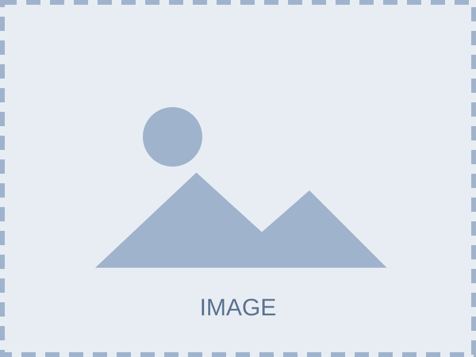

### いつ使うか

スライド・プレゼン資料・発表資料の作成や修正を頼まれたとき。
スライドは [Marp](https://marp.app/) の Markdown ファイル (例 `slides/発表名.md`) として作ります。
ファイルの作成・修正は、ほかのファイルと同じ方法 (apply-patch スキルがあればそのパッチ) で行います。

### 新しく作るとき (最初の 1 回は slideinit もいっしょに)

スライドの Markdown を新しく作るパッチを出すときは、**同じ 1 つのコードブロックの中で、パッチより前に
`slideinit` を実行**するようにします。`slideinit` は、スライドのフォルダ (既定 `slides/`) に既定の画像
(表紙の背景 `assets/background.png`・ロゴ `assets/logo.png`)・テーマ (`assets/kit-slides.css`)・
VS Code のプレビュー用の設定 (`.vscode/settings.json`) をそろえる関数です (何度実行しても同じで、既にある画像は上書きしません)。

- apply-patch スキルのコマンドの 1 行目 (`$OutputEncoding = ...`) の次の行に `slideinit` を 1 行入れ、
  その後にいつものパッチ (`@'` 〜 `'@ | python ...`) を続けます。コードブロックは 1 つです。
- スライドを `slides/` 以外のフォルダに置くときは、`slideinit <フォルダ>` と書きます。
- 2 回目以降 (作ったスライドの修正、同じフォルダへのスライドの追加) は `slideinit` を付けず、パッチだけを出します。

```powershell
$OutputEncoding = [System.Text.UTF8Encoding]::new($false)
slideinit
@'
*** Begin Patch
*** Add File: slides/発表名.md
+---
+marp: true
+theme: kit-slides
+paginate: true
+footer: ""
+---
+
+<!-- _class: cover -->
+
+
+
+# 発表のタイトル
+
+〇〇部 △△課
+2026年11月25日
+
+---
+
+## スライドのタイトル
+
+- 要点 1
+- 要点 2
*** End Patch
'@ | python ${CTX} run -- python ${SKILLS_DIR}/apply-patch/apply.py -f -
```

### スライドの形 (必ずこの形)

- **1 枚目は表紙**。背景画像の上、中央の横線の上側にタイトル、下側に部署名と日付 (すべて左寄せ)。
- **2 枚目以降**は、ヘッダー (スライドのタイトルのみ) とフッター (左端に「ページ数 / 総ページ数」、
  右端にロゴ画像) を、線で本文と区切ります。
- 見た目 (色・位置・線・ページ番号) はテーマ `kit-slides` が付けます。Markdown に `<style>` や
  位置を決める HTML を書かないでください。

### 書き方

```markdown
---
marp: true
theme: kit-slides
paginate: true
footer: ""
---

<!-- _class: cover -->


# 発表のタイトル

〇〇部 △△課
2026年11月25日

---

## スライドのタイトル

- 要点 1
- 要点 2

---

## 次のスライドのタイトル

### 小見出し

本文
```

決まり:

1. 先頭のフロントマター (`marp` 〜 `footer`) はこのまま書きます。`footer` はロゴの画像で、全ページ右下に出ます。
2. 表紙は `<!-- _class: cover -->`、``、`# タイトル`、
   その下に部署名と日付を **改行で 2 行に並べた 1 つの段落** で書きます (間に空行を入れない)。
   表紙には `#` 以外の見出しや箇条書きを書きません。
3. 2 枚目以降は、各スライドの最初に **`## タイトル` を 1 つだけ** 書きます (これがヘッダーになります)。
   スライドの中の見出しは `###` 以下を使います (`#` や 2 つ目の `##` は使わない)。
4. スライドの区切りは `---` だけの行 (前後に空行) です。
5. 1 枚に詰め込みすぎないでください。目安は箇条書き 6 行、表 6 行程度まで。あふれる内容は複数のスライドに分けます。
6. 日付をユーザーが指定しなければ、今日の日付を `YYYY年M月D日` で書きます。部署名が分からなければ
   `〇〇部` のような仮の値を入れ、差し替えるよう一言添えます。
7. 背景やロゴにユーザー自身の画像を使う場合は、`assets/background.png` / `assets/logo.png` を
   その画像のパス (スライドの Markdown からの相対パス) に書き換えます。

### 文字の強調 (色を変える)

- いちばん伝えたい言葉は `*言葉*` (アスタリスク 1 つで囲む) と書くと、**赤の太字**になります (斜体にはなりません)。
- `**言葉**` (アスタリスク 2 つ) は黒の太字です。色を変えるほどではない強調に使います。
- 色の強調は 1 枚に 1〜2 か所までにします (多いと目立たなくなります)。見出し (`##` `###`) の中には使いません。
- 囲む言葉の両端に句読点やかっこを入れません (`*重要。*` や `*「重要」*` は強調になりません)。
  `回答までに*平均 2 日*かかる` のように、言葉だけを囲みます。
- HTML (`<span style="color: ...">` など) や、ほかの色は使いません。

### 本文のレイアウト (2 枚目以降)

内容に合わせて、`## タイトル` の前に `<!-- _class: ... -->` を 1 行書くと、次のレイアウトにできます。
付けなければ 1 カラムです。

| クラス | レイアウト | 使う場面 |
| --- | --- | --- |
| `cols` | テキストの 2 カラム | 2 つのものの比較 (現行と新方式、メリットとデメリットなど) |
| `image-right` | 左にテキスト、右に画像 | 画面のイメージ、図、写真の説明 |
| `image-left` | 左に画像、右にテキスト | 同上 (`image-right` が続くときに左右を変える) |
| `table` | 1 カラムで、真ん中に大きな表 | スケジュール、一覧、比較表など、表が主役のスライド |
| `image` | 1 カラムで、真ん中に大きな画像 | 構成図、画面のスクリーンショットなど、画像が主役のスライド |
| `center` | 1 カラムで、ど真ん中に大きめのテキスト | まとめ、結論、伝えたい 1 つのメッセージ、お願いごと |

```markdown
---

<!-- _class: cols -->

## 現行と新方式の比較

### 現行

- 要点 1
- 要点 2

### 新方式

- 要点 1
- 要点 2

---

<!-- _class: image-right -->

## 画面のイメージ

- 説明 1
- 説明 2



---

<!-- _class: table -->

## 導入スケジュール

| 時期 | 内容 | 担当 |
| --- | --- | --- |
| 2027年1月 | 要件定義 | 業務改善課 |
| 2027年4月 | 試験運用 | 開発課 |

---

<!-- _class: image -->

## システム構成


構成図の説明 (1 行)

---

<!-- _class: center -->

## まとめ

### 伝えたいことを 1 行で

補足を 1 行で
```

- `cols` は **`###` 小見出しをちょうど 2 つ** 書きます。1 つ目の `###` から左のカラム、2 つ目の `###` から右のカラムになります。
  各カラムの中身は箇条書きか短い段落にし、左右の分量をそろえます。
- `image-right` / `image-left` は、テキストを先に書き、最後に **画像だけの行** `` を 1 つ書きます
  (画像は本文の高さに合わせて縮小されます)。テキストは本文の半分の幅しか無いので、1 行を短くし、5 行程度までにします。
- `table` は表を **1 つだけ** 書きます。表は本文の幅いっぱいに広がり、上下の真ん中に置かれます。
  表の前に `###` 小見出しを 1 つ書いてもかまいません。表は 8 行程度までにし、多ければスライドを分けます。
- `image` は **画像だけの行** `` を 1 つ書きます。画像は残りの高さいっぱいに拡大・縮小されます。
  画像の前に `###` 小見出し、後ろに 1 行の説明 (キャプション) を書いてもかまいません。
- `center` は文字が大きく中央ぞろえになります。`###` 小見出し 1 つ (いちばん伝えたいこと) と 1〜2 行の段落、
  または 3 行程度までの短い箇条書きにします。長い文章や表は書きません。
- 使う画像がまだ無いときは `assets/placeholder.svg` (仮の画像) を書き、差し替えるよう一言添えます
  (仮の画像のファイルは、書き出し (`slidepdf` / `slidepptx`) のときにコピーされます)。
- 画像を左右に置くために `` や HTML は使いません (ヘッダーとフッターの線が崩れます)。

### 図を SVG で作る (フロー図・構成図など)

手順の流れ・システムの構成・関係などは、図を SVG ファイルとして作り、画像として貼ると伝わりやすくなります。

- 図は `slides/assets/<図の名前>.svg` (スライドの Markdown と同じフォルダの `assets/`) に、
  スライドと同じパッチの `*** Add File:` で作ります。スライドには `` と書きます。
- 置き場所は `image` (真ん中に大きく)・`image-right` / `image-left` (テキストの横) のレイアウトにします。
- 大きさは置き場所に合わせ、`<svg>` に `width`・`height`・`viewBox` を同じ値で書きます (この大きさのまま表示されます)。
  - `image`: `width="1100" height="440" viewBox="0 0 1100 440"` (前後に `###` と説明を書くとき)
  - `image-right` / `image-left`: `width="560" height="480" viewBox="0 0 560 480"`
- 見た目はスライドに合わせます。
  - 文字: `font-family="Segoe UI, Meiryo, sans-serif"`、大きさは 20〜28 (小さすぎると読めません)、色は `#222222`
    (補足は `#666666`、強調は `#d32f2f`)
  - 箱: `<rect rx="10" fill="#f3f5f8" stroke="#b3b3b3" stroke-width="2"/>`。主役の箱だけ
    `fill="#e8eef6" stroke="#1f4e8c" stroke-width="3"` にします
  - 線と矢印: `stroke="#666666" stroke-width="3"`。矢印の先は `<polygon>` の三角形で描きます
    (PowerPoint で崩れないように `marker` は使いません)。戻りや補助の線は `stroke-dasharray="10 8"`
- SVG は自動で折り返さないので、文字は短くし、箱の幅を「文字数 × 文字の大きさ + 40」以上にします。
  2 行にするときは `<text>` を 2 つ書きます。文字を箱の真ん中に置くときは `text-anchor="middle"` を使い、
  縦の位置は `y` で決めます (`dominant-baseline` は使いません)。
- 使うのは `rect`・`line`・`polyline`・`polygon`・`circle`・`path`・`text` だけにします。
  `<style>`・`class`・`<foreignObject>`・`filter`・外部の画像やフォントは使いません。
- 見本: `${SKILL_DIR}/assets/example-flow.svg` (見本のスライド `example.md` の「システム構成」で使っています)。
- PowerPoint (`slidepptx`) では、図は SVG の画像として入ります。PowerPoint で図を右クリックして
  「図形に変換」すると、箱や文字を個別に編集できると伝えてください。

### 書き出し

スライドのファイルを作ったら (または修正したら)、書き出すコマンドを示します
(`<スライドのパス>` は実際のパスに置き換える)。PDF は `slidepdf`、PowerPoint は `slidepptx` です。

```powershell
slidepdf "<スライドのパス>"
```

```powershell
slidepptx "<スライドのパス>"
```

- パスを省くと `slides/` の `*.md` をすべて書き出します。フォルダを指定するとその中の `*.md` を書き出します。
- 出力はスライドと同じ場所に、同じ名前で拡張子を `.pdf` / `.pptx` にしたファイルです。
- `slidepptx` の PowerPoint は、文字・箇条書き・番号・表が PowerPoint のテキストや表として編集でき、
  位置はテーマと同じになります (Python だけで作るので、Marp CLI・ブラウザ・ほかのソフトは不要)。
  この書き方 (上の決まり) から外れた Markdown や HTML は再現されません。文字の折り返し位置が PDF と
  1 文字ほど違うことがあると伝えてください。画像は SVG のまま入るので、PowerPoint 2016 以降で開くよう伝えてください。
- 書き出しのときも `slideinit` と同じ準備 (足りない画像・テーマ・VS Code の設定) をします。
  既にある画像は上書きされないので、同じ名前の画像を置けば差し替えられます。
- VS Code のプレビューで `theme: kit-slides` が「not recognized」と警告されるときは、`slideinit` を実行し、
  VS Code のウィンドウの再読み込みを案内してください。
- `slidepdf` などの関数が見つからないと言われたら、キットのフォルダで `python install.py` を実行して
  PowerShell を開き直すよう案内してください。関数を使わない場合は
  `python ${CTX} run -- python ${SKILL_DIR}/build.py "<スライドのパス>"` (PowerPoint は末尾に `--pptx`) でも書き出せます。
- Marp CLI は同梱の `marp.zip` の単体版を使うので、Node.js は不要です (Windows)。
  PDF の書き出しには Edge か Chrome を使います。
  「Marp CLI が見つかりません」と表示されたら (zip にその OS 用が無い場合)、Node.js のインストールを案内してください。
