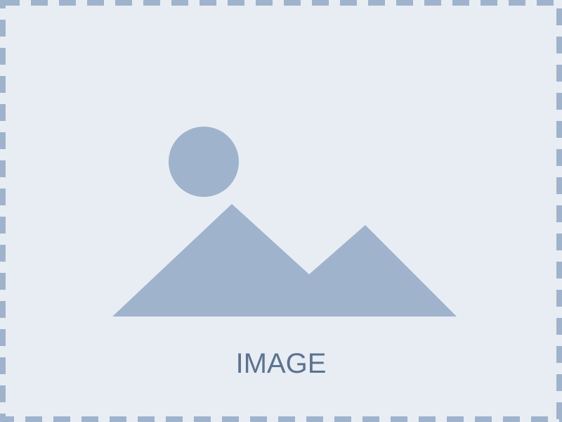

<!-- _class: cover -->

# 社内問い合わせ対応の AI 化について

情報システム部 業務改善課
2026年11月25日

---

## 本日の内容

1. 現状の課題（1 カラム・入れ子の箇条書き）
2. 解決の方針（1 カラム・小見出し）
3. 現行と新方式の比較（2 カラム）
4. 画面のイメージ（右に画像）
5. 運用の流れ（左に画像）
6. 導入スケジュール（真ん中に大きな表）
7. システム構成（真ん中に大きな画像）
8. 費用と効果（1 カラム・表と箇条書き）
9. まとめ（ど真ん中にテキスト）

---

## 現状の課題

- 問い合わせ件数が増え続けている
  - 2024年度：月 1,200 件
  - 2026年度：月 2,000 件（見込み）
- 回答までに平均 2 営業日かかる
- 同じ質問への回答が担当者ごとにばらつく

---

## 解決の方針

### 定型の質問は AI が一次回答する

- 社内規程と過去の回答をもとに、AI が回答案を作る
- 担当者は内容を確認して送るだけにする

### 難しい質問は担当者に引き継ぐ

- AI が回答できないものは、要点をまとめて担当者に渡す

---

<!-- _class: cols -->

## 現行と新方式の比較

### 現行の対応

- 担当者がメールで個別に回答する
- 回答まで平均 2 営業日
- 回答の品質が担当者ごとにばらつく

### 新方式

- AI が規程をもとに回答案を作る
- 担当者は確認して送るだけ
- 回答まで当日中を目標にする

---

<!-- _class: image-right -->

## 画面のイメージ

- 社内ポータルから質問を入力する
- AI の回答案がすぐに表示される
- 解決しなければ担当者に引き継ぐ

---

<!-- _class: image-left -->

## 運用の流れ

### 一次回答

AI が回答案を作り、担当者が確認する。

### 引き継ぎ

難しい質問は要点をまとめて担当者へ。

---

<!-- _class: table -->

## 導入スケジュール

| 時期 | 内容 | 担当 | 状態 |
| --- | --- | --- | --- |
| 2027年1月 | 要件定義 | 業務改善課 | 準備中 |
| 2027年3月 | 試作と評価 | 開発課 | 未着手 |
| 2027年5月 | 一部部署で試験運用 | 業務改善課 | 未着手 |
| 2027年7月 | 全社展開 | 情報システム部 | 未着手 |
| 2027年9月 | 効果測定 | 業務改善課 | 未着手 |

---

<!-- _class: image -->

## システム構成

### 問い合わせ対応システムの全体像

社内ポータル・AI・担当者の受付画面をつなぐ

---

## 費用と効果

| 項目 | 金額（年間） |
| --- | --- |
| 利用料 | 360 万円 |
| 保守・運用 | 240 万円 |
| 削減できる工数 | 約 1,500 時間 |

- 工数の削減分で、費用は 2 年目に回収できる見込み

---

<!-- _class: center -->

## まとめ

### 定型の問い合わせは AI に任せる

担当者は、判断が必要な問い合わせに集中する
